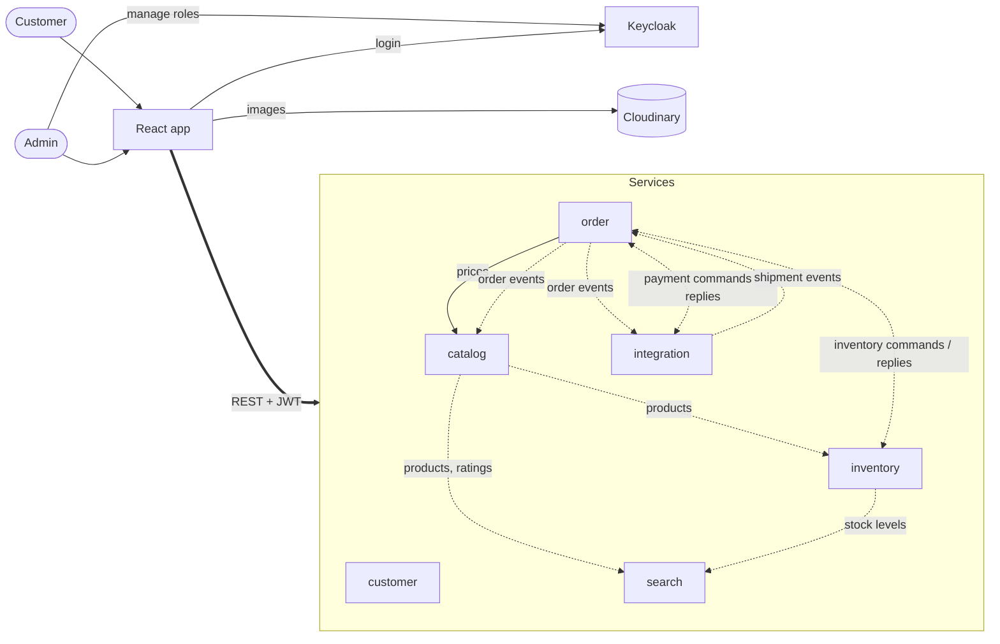
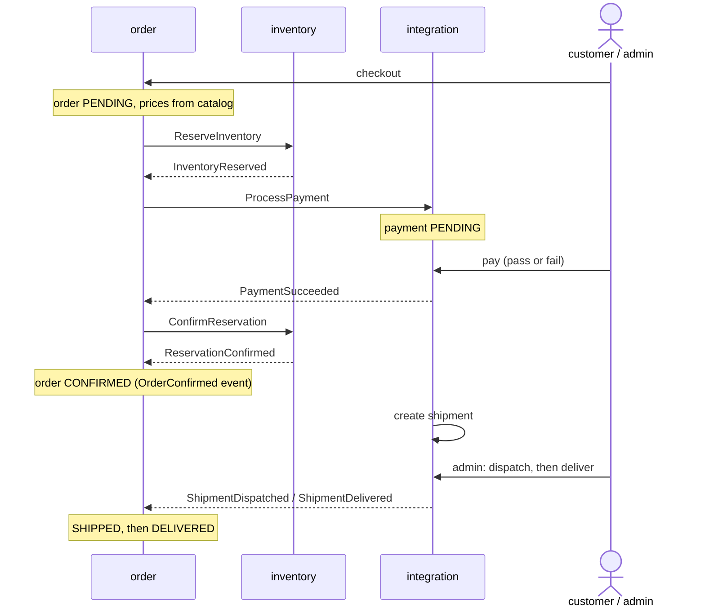

# Spring Ecommerce Microservices

An event-driven online shop: six Spring Boot services that talk over Kafka, an orchestrated order saga, Keycloak for login and a React frontend.

**Live:** https://34-8-188-125.sslip.io

> **Screenshots coming soon**
> - Shop / search page
> - Product page with reviews
> - Checkout and dummy payment
> - Order tracking
> - Admin: products, stock and shipments

## Tech stack

Java 21, Spring Boot 4, Kafka (Confluent Cloud), PostgreSQL + Flyway, Redis, Keycloak, Cloudinary, React 19 + Vite + TypeScript, Docker, GKE, GitHub Actions.

## Services

| Service | Does |
|---|---|
| customer | Profile picture and saved addresses. A profile is created on the first request from a new Keycloak user. |
| catalog | Products and reviews. Only customers whose order was delivered can review. |
| inventory | Stock, plus reserving, confirming and releasing it for orders |
| order | Cart, checkout and the saga that drives every order |
| integration | Dummy payments and shipping, and Cloudinary upload signatures |
| search | A read-only product search kept up to date from events (price, stock, rating) |

Each service has its own Postgres database. Services never read each other's tables.

## How it works



Solid arrows are REST calls; dotted arrows are Kafka messages:

| Topic | From | To |
|---|---|---|
| catalog.products | catalog | inventory, search |
| review.product-ratings | catalog | search |
| inventory.stock-levels | inventory | search |
| order.events | order | catalog (who may review), integration (create shipment) |
| inventory.commands | order | inventory |
| inventory.replies | inventory | order |
| payment.commands | order | integration |
| payment.replies | integration | order |
| shipment.events | integration | order |

**Customers** register through Keycloak, then:
1. Browse and search products.
2. Add products to their cart and check out with one of their saved addresses.
3. Pay with the dummy payment, choosing whether it passes or fails.
4. Track the order and review the product once it's delivered.

**Admins** (the seeded `admin1`, plus anyone they promote in the Keycloak console):
1. Create and edit products, uploading images straight to Cloudinary with a signature from the integration service.
2. Restock inventory.
3. Move shipments along: dispatch, deliver, or fail them.

Every role check happens in the services; the frontend only hides buttons.

## Order saga

The order service orchestrates each order. It sends commands over Kafka, waits for replies, and records the current step in `order_saga`, so a restart picks up where it left off.

### Happy path



### Saga steps

| Step | Waiting for | On success | On failure |
|---|---|---|---|
| RESERVING_INVENTORY | Stock to be reserved | Ask for payment | Order FAILED (out of stock). Nothing to undo. |
| PROCESSING_PAYMENT | The customer to pay | Confirm the reservation | Release the reserved stock, then mark FAILED |
| CONFIRMING_INVENTORY | Stock to be taken for good | Order CONFIRMED | Refund the payment, then mark FAILED |
| RELEASING_INVENTORY | Stock to go back (compensation) | Order FAILED | n/a |
| REFUNDING | The refund (compensation) | Order FAILED | n/a |

### When things go wrong

- **Payment declined, or the wrong amount paid:** the reserved stock is released and the order fails with `DECLINED` or `AMOUNT_MISMATCH`.
- **The customer never pays, or a step gets no reply:** a timeout job checks every 30 seconds. After 10 minutes on one step, it compensates: stock is released, any payment is refunded, and the order fails with `TIMEOUT`. Steps that must finish (confirming stock, refunding) resend their command instead.
- **Backstop:** inventory also expires a reservation that hasn't been confirmed after 15 minutes, so stock is never stuck.
- **Shipment fails (admin):** this can happen after confirmation. The order fails, the payment is refunded, and the stock is returned.

### Why it's safe

- **Transactional outbox:** every command and event is saved in the same database transaction as the change that caused it. A poller (`outbox-lib`) then sends it to Kafka, so nothing is lost or sent for a change that rolled back.
- **Idempotent consumers:** each handled event id is recorded in `processed_event`, so a message delivered twice is applied once.
- **Guarded transitions:** a step only moves forward if the order is still on the step the reply expects (for example, `PROCESSING_PAYMENT → CONFIRMING_INVENTORY`). Late or duplicate replies are ignored.
- **Ordering:** messages are keyed by order id, so each order's messages are handled in order.
- **Idempotent checkout:** checkout takes an idempotency key, so a double-clicked "Place order" creates one order.

## Run locally

You'll need Docker, plus free accounts for two cloud services:

- **[Confluent Cloud](https://confluent.cloud):** provides Kafka, which every service uses to exchange events. Create a basic cluster, the 9 topics listed in the diagram above, and an API key.
- **[Cloudinary](https://cloudinary.com):** stores product and profile images. The browser uploads directly to Cloudinary using a short-lived signature from the integration service. It's only needed if you want images.

Then:

```bash
cp .env.example .env
```

Put your Confluent bootstrap server, API key and secret, and your Cloudinary cloud name, key and secret into `.env`, then start the stack:

```bash
docker compose --profile all up -d
```

- **Shop:** http://localhost:8000
- **API docs:** http://localhost:8000/swagger
- **Admin login:** `admin1` / `test1234` (local only)

Running everything needs about 4 GB of RAM free for Docker. On a smaller machine, start only the services you need, for example `docker compose --profile catalog --profile search up -d`. Profiles are named after each service, plus `shop`, `proxy` and `all`.

To work on the frontend alone, run `npm run dev:mock` in `frontend/`. It needs no backend: the APIs are mocked from `openapi/` and login is faked.

## CI/CD

GitHub Actions runs on every push: it tests each service against Postgres, lints and builds the frontend, and builds every Docker image. Pushes to `main` also publish the images and deploy them to GKE. Setup and operations are in [k8s/README.md](k8s/README.md).
